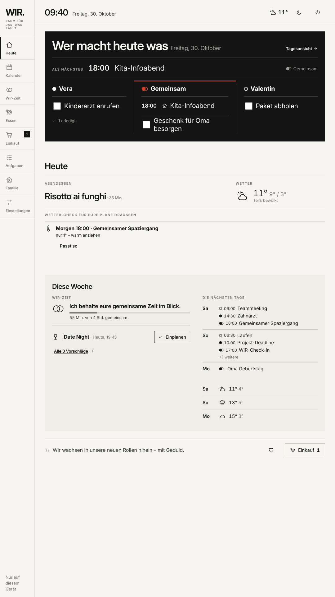
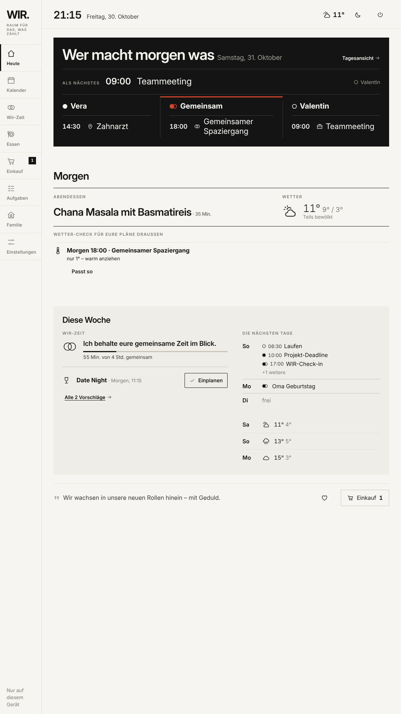
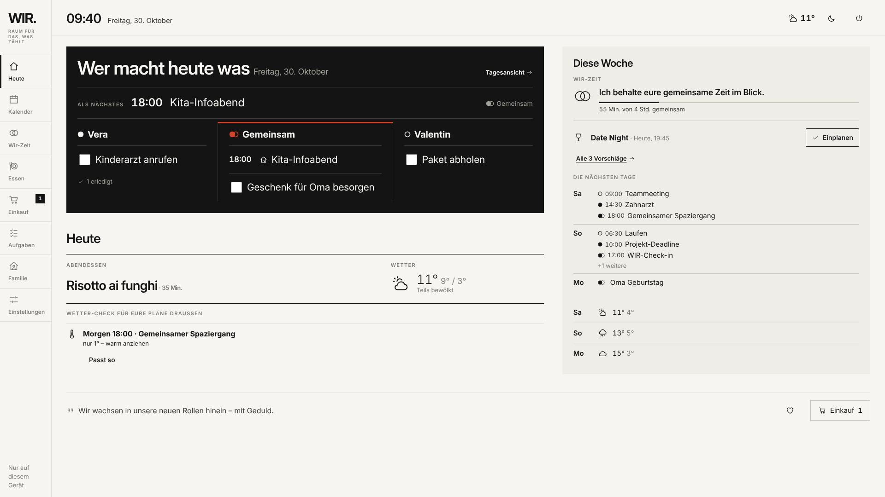
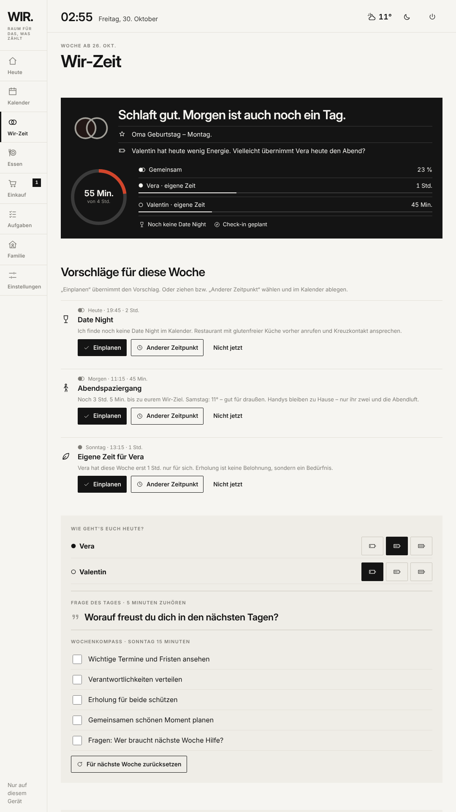
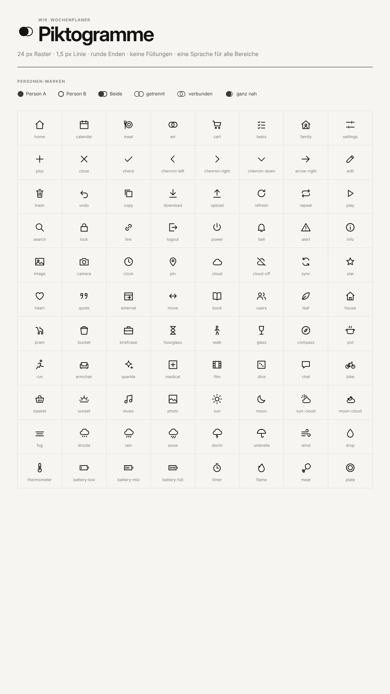
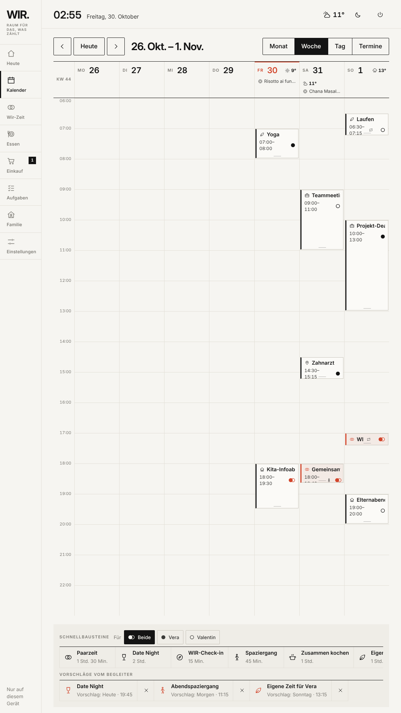
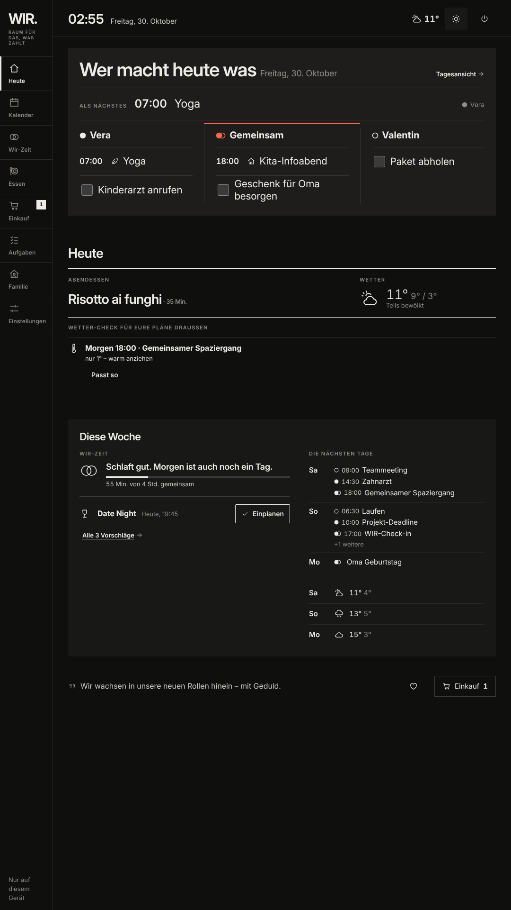

# Gestaltung: ruhig, klar, gemeinsam

Der Planer hängt im Wohnraum, also gilt: **wenig Aufregung, viel Übersicht.** Die Gestaltung folgt dem
Schweizer bzw. editorialen Stil: Raster, Typografie und Weißraum ordnen die Inhalte statt Farben,
Verläufe und Emojis. Im Mittelpunkt steht, dass zwei Menschen den Plan **gemeinsam** benutzen.

## Acht Grundsätze

Jeder Grundsatz hat ein Piktogramm aus dem eigenen Satz (Übersicht unten).

| | Grundsatz | Was das heißt |
|---|---|---|
| **01** · Raster | Alles sitzt auf einem Raster | Sieben Spalten für die Woche, drei Spalten für „Heute“, 8-px-Abstände. Spalten trennen sich durch Haarlinien, nicht durch Kästen. |
| **02** · Typografie | Eine Schrift, klare Stufen | Nur *Inter* (variabel, im Projekt enthalten, kein Laden aus dem Netz). Große, leichte Ziffern für Uhr und Temperatur, kräftige Titel, kleine Versalien für Rubriken („HEUTE · WER MACHT WAS“). Ziffern mit fester Breite, damit Zeiten untereinander stehen. |
| **03** · Schwarz-Weiß + ein Signal | Farbe bedeutet etwas | Papierweiß und Schwarz. Genau **eine Signalfarbe** (Zinnoberrot) markiert *gemeinsame Zeit* und *heute/jetzt*. Warnfarben gibt es nur bei amtlichen Wetterwarnungen. Nachtmodus: dieselben Regeln, invertiert. |
| **04** · Piktogramm statt Emoji | Eine Bildsprache | 88 Piktogramme im 24-px-Raster, 1,5 px Linie, runde Enden, ohne Füllung (`src/ui/Icon.tsx`). Emojis sehen auf jedem Gerät anders aus und sind laut – Piktogramme bleiben ruhig und einheitlich. |
| **05** · Gemeinsam zuerst | Wer macht was – auf einen Blick | Personen haben **Formen statt Farben**: ● Person A (gefüllt), ○ Person B (Ring), zwei Kreise = gemeinsam. Die Startseite ordnet den Tag in drei Spalten: Person A · **Gemeinsam** (Mitte, Signalfarbe) · Person B. |
| **06** · Ruhe in der Bewegung | Bewegung erklärt, statt zu unterhalten | Kurze Überblendungen (0,15–0,2 s), Ring und Balken füllen sich einmal. Kein Hüpfen, Pulsieren oder Schweben. „Bewegung reduzieren“ des Systems wird beachtet. |
| **07** · Ebenen statt Gleichrang | Das Auge weiß, wohin | Jede Seite hat **drei Ebenen** (siehe unten): eine dunkle Hauptfläche, Papier mit Haarlinien, eine getönte ruhige Fläche. Dazwischen großer Abstand, innerhalb kleiner. Ecken sind gerade (2 px), Schatten gibt es nicht. |
| **08** · Eine Aufgabe pro Bereich | Klare Wege | Jeder Bereich hat eine Rubrik, eine Hauptaktion (gefüllter Knopf) und höchstens zwei Nebenaktionen (Rahmen, ohne Rahmen). Navigation links mit Piktogramm **und** Wort, aktiv = schwarzer Balken. |

## Drei Ebenen: wohin das Auge wandert

Vorher sah jedes Widget gleich aus (gleiche Linie, gleiche Rubrik, gleicher Abstand, drei gleich breite Spalten) –
alles wirkte gleich wichtig. Jetzt hat jede Seite eine feste Rangfolge:

| Ebene | Fläche | Auf der Startseite | Woanders |
|---|---|---|---|
| **1 · Hauptsache** | dunkle Fläche (`.zone--hero`), größte Schrift, genau **eine** pro Seite | **Wer macht heute was**: „Als Nächstes“ und drei Spalten Person A · Gemeinsam · Person B mit Terminen und Aufgaben | Wir-Zeit: Stand der Woche mit Ring |
| **2 · Heute** | Papier, schwarze Linie oben, Haarlinien (`.zone`) | Abendessen (nur zum Lesen), Wetter heute, Wetter-Check nur bei Risiko, morgens der Energie-Check-in | Vorschläge, Rezepte, Kalender |
| **3 · Hintergrund** | getönte Fläche (`.zone--quiet`), kleinere Titel | **Diese Woche**: Wir-Zeit in einem Satz mit **einem** Vorschlag, die nächsten drei Tage, Wetter-Ausblick | Bausteinleiste im Kalender, Wochen-Essensplan, Frage des Tages, Ideen |
| Rand | ohne Fläche | Gedanke des Tages (eine Zeile), Einkaufszähler | – |

**Abstände in zwei Größen:** innerhalb einer Gruppe `--s2`/`--s3` (8/16 px), zwischen den Ebenen `--s6` (64 px).
**Schriftstufen:** Seite 40 · Ebene 28 (Hauptfläche 40) · Eintrag 18–21 · Meta 13 px.
**Anzeige vor Bearbeitung:** Auf der Startseite steht nur, was man im Vorbeigehen lesen will. Portionen,
mehrere Vorschläge oder 7-Tage-Wetter liegen eine Berührung tiefer auf den jeweiligen Seiten.

**Nach Tageszeit:** Ab 20:30 Uhr zeigt die Startseite schon den nächsten Tag („Wer macht morgen was“, Essen von
morgen). Der Energie-Check-in erscheint nur vormittags, solange er noch nicht ausgefüllt ist.

Im Querformat steht die Hauptfläche links, „Diese Woche“ rechts daneben:

## Das WIR-Zeichen

Zwei Kreise – zwei Menschen, ein Plan. Der Begleiter zeigt seine Stimmung nicht mit einem Gesicht, sondern
über den **Abstand der Kreise**: Habt ihr viel gemeinsame Zeit, rücken sie zusammen (bei erreichtem Ziel
gefüllt), wird die Woche dicht, stehen sie weiter auseinander. Nachts wird das Zeichen grau.

**Fortschrittsring:** Die Füllung liegt exakt auf der Spur. Technisch dreht sich das ganze SVG um −90°
(Start oben), animiert wird nur die Strichlänge (`pathLength`) – vorher wurde der Kreis selbst um einen
falschen Mittelpunkt gedreht und lag daneben.

## Piktogramme

Die Übersicht ist in der App unter `…/#piktogramme` erreichbar. Neue Piktogramme kommen in `src/ui/Icon.tsx`
dazu – im 24er-Raster, Linie 1,5 px, möglichst aus Grundformen (Kreis, Linie, Rechteck).

| Verwendung | Piktogramme |
|---|---|
| Navigation | home, calendar, wir, meal, cart, tasks, family, settings |
| Kategorien | wir (Wir), leaf (Ich), house (Familie), pram (Baby), bucket (Haushalt), briefcase (Arbeit), pin (Termin), hourglass (Frist) |
| Wetter | sun, moon, sun-cloud, moon-cloud, cloud, fog, drizzle, rain, snow, storm, wind, umbrella, thermometer, drop |
| Energie | battery-low, battery-mid, battery-full |
| Essen | plate, leaf (vegetarisch), meat (Fleisch optional), flame (Airfryer), book (Grundrezept), timer |

Küchen tragen statt Flaggen ein **Kürzel** in einem Rahmen (IT, DE, FR, AS, IN, MX, GR, ES, LV, AF, FF) –
wie auf einer Abfahrtstafel. Rezeptkarten sind rein typografisch.

## Farben (Design-Tokens)

| Token | Tag | Nacht | Wofür |
|---|---|---|---|
| `--paper` | `#f6f5f1` | `#0f0f0e` | Fläche |
| `--ink` | `#141414` | `#ecebe6` | Text, Linien, gefüllte Knöpfe |
| `--muted` | `#7d7b75` | `#8f8d86` | Nebentext |
| `--line` | `#e2dfd7` | `#2a2926` | Haarlinien |
| `--accent` | `#d2452b` | `#ef6a4f` | Gemeinsam, heute, jetzt |
| `--wir-fill` | Signal 6 % | Signal 8 % | Hintergrund gemeinsamer Termine |

Alle Werte stehen in `src/styles/base.css`.

